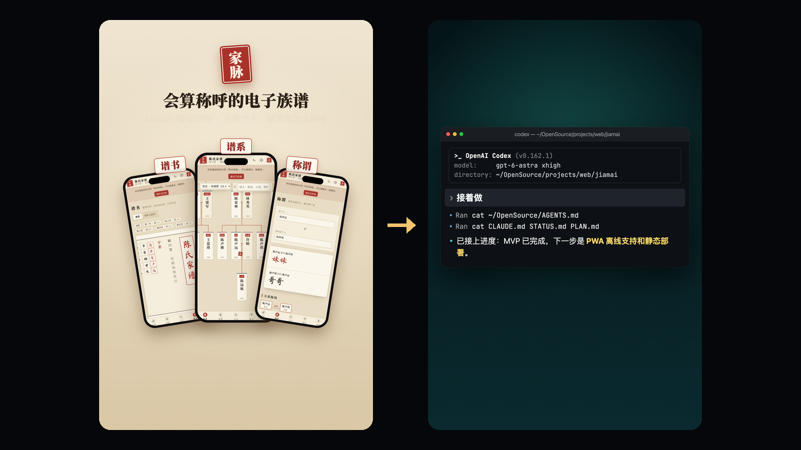
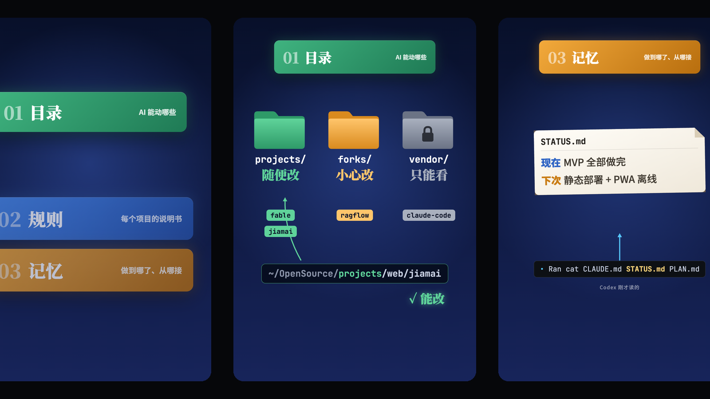
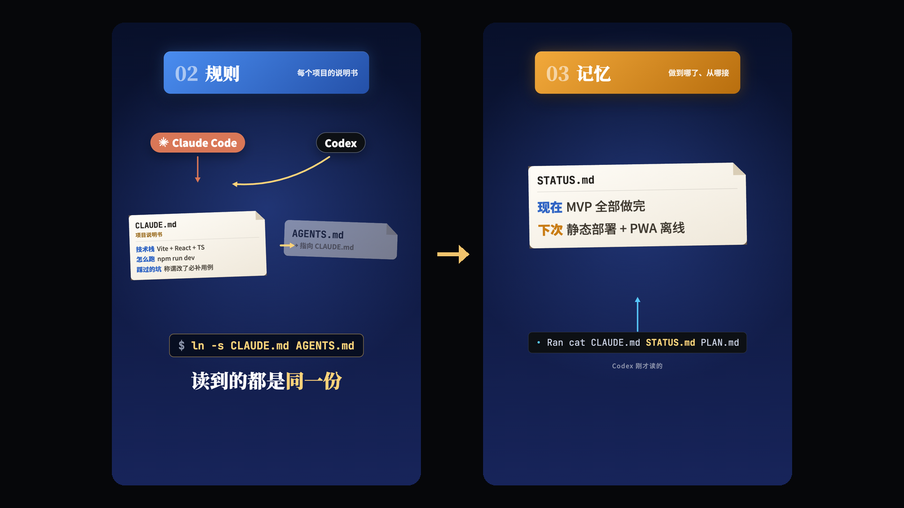

<div align="center">

# 🗂️ AI Workspace

**AI 的记忆放在你自己的文件里。换哪个 AI 都行，说一句「接着做」，它就从上一个停下的地方接着干。**

<p align="center">
  <a href="README.md"></a>
  <a href="README.zh-CN.md"></a>
</p>

**把这句话发给你的 AI：**

```text
帮我按 ai-workspace 把工作区搭好，照这份说明做：https://raw.githubusercontent.com/Oldcircle/ai-workspace/main/INSTALL.md
```

<p align="center">
  <a href="LICENSE"></a>
  <a href="https://agentskills.io"></a>
  <a href="https://www.python.org/downloads/"></a>
  
</p>

<p align="center">
  <b>适用于</b><br>
  <a href="https://code.claude.com/docs/en/memory"></a>
  <a href="https://learn.chatgpt.com/docs/agent-configuration/agents-md"></a>
  <a href="https://cursor.com/docs/context/rules"></a>
  <a href="https://geminicli.com/docs/cli/gemini-md/"></a>
  <a href="https://opencode.ai/docs/rules/"></a>
  <a href="https://docs.github.com/en/copilot/how-tos/copilot-cli/add-custom-instructions"></a>
  <br><sub>……以及其他能读文件的 agent。</sub>
</p>



*Claude 写了一半的项目，换 Codex 打开，只说「接着做」。它读了工作区规则和项目的 STATUS.md，报出的下一步和上次停下的地方一模一样。*

</div>

---

## 30 秒上手

把这句话发给你正在用的 AI（Claude Code、Codex、Cursor、Gemini CLI、OpenCode、Copilot CLI 都行）：

```text
帮我按 ai-workspace 把工作区搭好，照这份说明做：https://raw.githubusercontent.com/Oldcircle/ai-workspace/main/INSTALL.md
```

它会自己装好 skill，问你工作区放哪、模板要中文还是英文，然后从零搭一个，或者把你现有的文件夹整理好（动文件之前会先给你看计划）。之后不管打开哪个 AI，在这个文件夹里说：

> 接着做

视频里那句「帮我按 ai-workspace 把工作区搭好」是简写。第一次一定要带上链接：没见过这个项目的 AI 不知道 ai-workspace 是什么。skill 装好以后，只说简写也行。

## 为什么用它

- **记忆在你手里。** 规则、进度、经验都是你文件夹里的 Markdown。不用登录谁的账号，也不用导出，没有哪样东西只存在某个产品里面。
- **换哪个 AI 都接得上。** 规则写在 `AGENTS.md`，Codex、Cursor、OpenCode、Copilot 直接就读。`CLAUDE.md` 是指向同一个文件的软链，给 Claude Code 用；Gemini CLI 改一个设置就行。
- **「接着做」怎么做，写在文件里。** 根目录的规则文件告诉每个 AI：先读你的偏好，再找最近更新的 `STATUS.md`，从「下次入口」开始。所以不管换成谁，接活的方式都一样。
- **文件不会越写越胖。** 每个文件有行数上限，每条信息只记一个地方，再配一个体检脚本。规则文件长到几百行以后 AI 就不怎么听了，体检脚本就是在那之前把它拦下来。
- **已经乱掉的工作区也能接。** adopt 模式先盘点、给你看计划、备份，然后才动手，不删任何文件。
- **不用一直开着什么服务。** 就是一个 skill（几份 Markdown）加两个只用 Python 标准库的脚本。

## 它是怎么组织的

<div align="center"></div>

<div align="center"><sub>目录告诉 AI 哪些能改（projects/ 随便改、forks/ 小心改、vendor/ 只能看）。STATUS.md 只写两件事：现在做到哪，下次从哪接。</sub></div>

前三层存记忆，第四层管着前三层别烂掉：

| 层 | 文件 | 解决什么 |
|---|---|---|
| **1. 目录** | `projects/` `forks/` `vendor/` `notes/` `memory/` `_archive/` | AI 看路径就知道能不能改：自己的项目随便改，fork 的小心改，参考代码只看不改。 |
| **2. 规则** | 根目录 `AGENTS.md`（路由表 + 项目索引）、每个项目一个 `AGENTS.md`、`CLAUDE.md` → `AGENTS.md` | 不用每次开会话都重新讲一遍项目，每个 AI 读到的规则也是同一份。 |
| **3. 记忆** | 每个项目的 `STATUS.md`、`PLAN.md`，`memory/MEMORY.md` 和条目文件，`notes/_index.md` | 对话关了、开新会话、换工具，进度和经验都还在。 |
| **4. 治理** | 每条信息只有一个家、文档预算、时态规矩、更新顺序、`lint.py` | 前三层用久了会慢慢变胖、变旧，这层专门防这个。 |

```
~/workspace/
├── AGENTS.md            # 路由表：怎么接着做、规矩、每个项目一行
├── CLAUDE.md -> AGENTS.md
├── memory/
│   ├── MEMORY.md        # 一条偏好或经验占一行
│   └── 提交信息要短.md
├── notes/_index.md
├── projects/
│   └── recipe-box/
│       ├── AGENTS.md    # 项目是什么、怎么跑、有什么约定
│       ├── CLAUDE.md -> AGENTS.md
│       ├── PLAN.md      # 目标和阶段
│       └── STATUS.md    # 当前状态 · 下次入口 · 待决策
├── forks/  vendor/  _archive/
```

### 为什么拆成很多小文件，不写一个大文件

模型不记事：你每发一句话，前面的对话都要重发一遍，聊得越久越贵；窗口满了还会自动压缩，细节就没了。每次都要读的规则文件也一样，每一轮都得带着，写得越长越贵，AI 也越记不住。

所以要拆开：启动时只读从根目录到当前项目那几份，子目录的文件等 AI 进了那个目录才读，细节放在链接后面，用到才打开。这叫渐进式加载，就像看书，先看目录，要哪章翻哪章。每条规矩为什么这么定、依赖各家 AI 的什么加载行为，写在 [`references/method.md`](skills/ai-workspace/references/method.md)。

## 换 AI 的时候发生了什么

<div align="center"></div>

<div align="center"><sub>Claude 认 CLAUDE.md，Codex 认 AGENTS.md：只写一份，另一个做成软链接。视频里的工作区是 CLAUDE.md 当本体；用本项目新建的工作区默认 AGENTS.md 当本体。哪个方向都行，只要一个文件夹里只有一份真文件。</sub></div>

你在任何一个 AI 里说「接着做」，它会：

1. 读根目录的 `AGENTS.md`（Claude Code 通过 `CLAUDE.md` 软链读到同一份）。
2. 读 `memory/MEMORY.md`，知道你的偏好。
3. 如果就在某个项目里，打开这个项目的 `STATUS.md`，从「下次入口」开始；如果在根目录，列出最近更新的两三个项目问你接哪个。
4. 停下之前更新 `STATUS.md`，留给下一个接手的。

这几步不依赖哪家厂商，不依赖装没装这个 skill，也不依赖任何聊天记录。哪天某个工具用不了了，换一个读的还是这些文件。

## 用之前和用之后

<div align="center"></div>

<div align="center"><sub>号会被封，对话会被压缩，但文件不会。</sub></div>

| | 之前 | 之后 |
|---|---|---|
| 开新会话 | 把项目背景再讲一遍 | 说「接着做」 |
| 进度在哪 | 在聊天记录里，早翻上去了 | `STATUS.md` 前 20 行 |
| 你的偏好 | 存在某个产品的记忆里，别的工具看不到 | `memory/`，哪个 AI 都读 |
| 换工具 | 从头来 | 同样的文件，同样的下一步 |
| 规则文件 | 越写越长，一半已经过时 | 路由表不到 200 行，细节在链接后面 |
| 同一个状态记在四个地方 | 互相对不上 | 每条只记一处，记重了体检会报 |

## 三种用法

| 模式 | 什么时候 | 怎么说 |
|---|---|---|
| **init** | 新文件夹，或者空的 | 「在 ~/workspace 搭一个 AI 工作区」 |
| **adopt** | 已经有一堆项目和规则文件 | 「接管我 ~/code 这个工作区，整理一下」 |
| **maintain** | 每一两周一次 | 「给我的工作区做个体检」 |

adopt 不删东西：先只读盘点，把数字和计划拿给你看，你点头之后，把要改的文件备份一份，再一类一类地改。

## 体检

```console
$ python3 ~/.agents/skills/ai-workspace/scripts/lint.py ~/workspace
ai-workspace lint 0.1.0 · /home/you/workspace
  ERROR L201  projects/api/AGENTS.md  AGENTS.md, CLAUDE.md are separate files in one folder: they will drift apart
               -> keep one real file and make the others symlinks to it (ln -s AGENTS.md CLAUDE.md), or a one-line '@AGENTS.md' import on Windows
  WARN  I401  AGENTS.md:83  index line is too long (82 wide, budget 60): Offline recipe app for one family, with ...
               -> one sentence of what it is; details go in the project's own files
  WARN  B131  projects/web/STATUS.md  STATUS body is 123 lines (budget 100)
               -> move superseded progress into the '## Archive' (## 归档) section at the bottom
  WARN  S302  projects/web/STATUS.md  no 'Next entry' heading near the top
               -> add '## Next entry' (## 下次入口): where the next session starts

1 error, 3 warnings, 0 info · 4 folders with instruction files
```

只读，不改任何文件，有 Python 3.8 就能跑。它查这些：文件有没有超预算，`AGENTS.md`/`CLAUDE.md` 是不是一真一链，`STATUS.md` 顶上有没有「当前状态」和「下次入口」，索引行是不是太长、有没有写日期，路径和链接有没有失效，有没有没人指向的记忆文件，同一句话是不是写在了两个文件里。给 AI 用加 `--json`，放进 CI 加 `--strict`。每个报错代码的意思和修法见 [`references/maintain.md`](skills/ai-workspace/references/maintain.md)。

## 支持哪些 AI

2026 年 10 月对照各家官方文档核对过。

| AI | 从哪读规则 | skill 目录（用户级） | 额外要做的 |
|---|---|---|---|
| [Claude Code](https://code.claude.com/docs/en/memory) | `CLAUDE.md`（软链到 `AGENTS.md`）；v2.1.277 起也能直接读 `AGENTS.md` | `~/.claude/skills/` | 可选：把 `autoMemoryDirectory` 指到 `<工作区>/memory` |
| [Codex](https://learn.chatgpt.com/docs/agent-configuration/agents-md) | `AGENTS.md`，从 git 根目录一路读到当前目录 | `~/.agents/skills/` | 无 |
| [Gemini CLI](https://geminicli.com/docs/cli/gemini-md/) | 默认读 `GEMINI.md`；把 `AGENTS.md` 加进 `context.fileName` 后也读它 | `~/.gemini/skills/` 或 `~/.agents/skills/` | 改一个设置，或者建 `GEMINI.md` 软链 |
| [Cursor](https://cursor.com/docs/context/rules) | 根目录和子目录的 `AGENTS.md` | `~/.cursor/skills/` 或 `~/.agents/skills/` | 无 |
| [OpenCode](https://opencode.ai/docs/rules/) | 最近的那个 `AGENTS.md`（没有才读 `CLAUDE.md`） | `~/.config/opencode/skills/` 或 `~/.agents/skills/` | 无 |
| [GitHub Copilot CLI](https://docs.github.com/en/copilot/how-tos/copilot-cli/add-custom-instructions) | `AGENTS.md`、`CLAUDE.md`、`GEMINI.md` 都读 | `~/.copilot/skills/` 或 `~/.agents/skills/` | 无 |
| Windsurf、Aider 等 | 未核实 | 未核实 | 如果它读 `AGENTS.md`，就什么都不用做 |

各家具体怎么加载、出处链接，见 [`references/agents.md`](skills/ai-workspace/references/agents.md)。

## 手动安装

```bash
git clone https://github.com/Oldcircle/ai-workspace
mkdir -p ~/.agents/skills ~/.claude/skills
cp -R ai-workspace/skills/ai-workspace ~/.agents/skills/            # Codex、Gemini CLI、Cursor、OpenCode、Copilot
ln -s ~/.agents/skills/ai-workspace ~/.claude/skills/ai-workspace   # Claude Code
```

然后跟 AI 说「搭一个 AI 工作区」，或者自己跑：

```bash
python3 ~/.agents/skills/ai-workspace/scripts/scaffold.py init ~/workspace --lang zh
```

## 常见问题

<details>
<summary><b>为什么不只做成一个 skill？</b></summary>

skill 只有装了它的 AI 才会加载。如果「接着做」要靠这个 skill，那换一个没装的 AI 就接不上了。所以 skill 只负责搭建和体检，接活需要的东西全写进工作区本身：根目录的 `AGENTS.md` 会告诉任何 AI 怎么接着做，哪怕它从来没听说过这个项目。
</details>

<details>
<summary><b>和 Claude Code 自带的记忆、ChatGPT 的记忆有什么区别？</b></summary>

自带的记忆属于那一个产品。Claude Code 的 auto memory 存在 `~/.claude/projects/…`，在你的项目外面，别的工具不会去读；ChatGPT 的记忆存在你的账号里。它们都好用，但带不走。这里的记忆是你自己的一个文件夹，可以用 git 管，哪个 AI 都能读。用 Claude Code 的话，可以把它的 auto memory 目录（`autoMemoryDirectory`）指到工作区的 `memory/`，这样它记下的东西别的 AI 也看得到。
</details>

<details>
<summary><b>从 Claude Code 换到 Codex，它怎么不知道我的偏好？</b></summary>

Claude Code 自己的记忆（`MEMORY.md` 和条目文件）存在 `~/.claude/projects/<项目>/memory/`，这是只有 Claude Code 会读的私有目录，写在那里的东西，换了工具就没了。偏好和跨项目经验要放在工作区的 `memory/` 文件夹里：根目录的 `AGENTS.md` 会让每个 AI 先读 `memory/MEMORY.md`。接管已有工作区时，AI 会把那些私有条目复制进 `memory/`（原文件不动）。想让 Claude Code 以后新记的也写进来，在 `~/.claude/settings.json` 里加 `"autoMemoryDirectory": "<工作区>/memory"`。
</details>

<details>
<summary><b>Windows 能用吗？</b></summary>

能。在 WSL 里和 Linux 完全一样。原生 Windows 建软链需要打开开发者模式或者用管理员终端，Git for Windows 默认也会把软链检出成普通文本文件（除非设了 `core.symlinks=true`）。建不了软链时，脚本会把 `CLAUDE.md` 写成一行 `@AGENTS.md`，Claude Code 会把它当成导入。别手动复制出两份一样的文件，时间一长两份就对不上了，体检会直接报错。
</details>

<details>
<summary><b>不会写代码能用吗？</b></summary>

能。`minimal` 布局只有项目、笔记、记忆、归档四个文件夹，写东西、做调研、整理资料都适用。脚本也不用你自己跑，AI 会跑。
</details>

<details>
<summary><b>会不会动坏我现有的文件？</b></summary>

init 从不覆盖已有文件。adopt 先全部只读看一遍，给你看计划，你同意之前什么都不改；要改写的文件先备份到 `_archive/`，「删除」一律是挪进 `_archive/`。别人仓库自带的规则文件（比如 fork 来的项目）不碰。
</details>

<details>
<summary><b>每次都读这么多文件，不费 token 吗？</b></summary>

比大多数人现在的做法省。每次会话固定读的只有路由表（不到 200 行）和记忆索引（不到 150 行）；项目文件只在 AI 进那个项目时才读，细节只在索引指过去时才打开。定预算本来就是因为每次都读的长文件每一轮都在花 token，而且写得越长，AI 越不听。
</details>

<details>
<summary><b>团队共用的仓库能用吗？</b></summary>

项目这一层可以：`AGENTS.md`、`STATUS.md`、`PLAN.md` 放在哪个仓库都行，体检脚本加 `--strict` 能放进 CI。个人偏好放你自己的 `memory/`，别写进团队的文件里。
</details>

## 仓库结构

```
ai-workspace/
├── INSTALL.md                 # 安装时给 AI 读的说明
├── skills/ai-workspace/       # skill 本体，复制这个文件夹
│   ├── SKILL.md
│   ├── references/            # 方法、各家 AI、init、adopt、maintain、写作规矩
│   ├── templates/{zh,en}/     # 路由表、项目说明、PLAN、STATUS、MEMORY、记忆条目、笔记索引
│   └── scripts/               # scaffold.py、lint.py（只用标准库）
├── tests/                     # python3 -m unittest discover -s tests
└── assets/readme/
```

## 参与贡献

欢迎提 issue 和 PR。各家 AI 的行为变得快，如果你发现官方文档和 [`references/agents.md`](skills/ai-workspace/references/agents.md) 写的不一样了，附上链接提个 PR 最有用。改 `lint.py` 的话，要带一个没这个改动就会失败的测试，再带一个证明干净的工作区还是干净的测试。

## 许可证

MIT，见 [LICENSE](LICENSE)。
